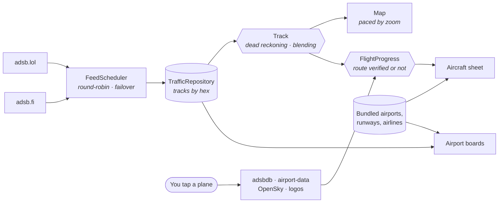

<div align="center">


<br><br>

**An Android app that shows every plane in the sky around you, live.**

It exists to answer one question: **what's that plane, and where's it going?**

<br>


[**Install it**](#install-it) · [**What it does**](#what-it-does) · [**Under the hood**](#under-the-hood) · [**Privacy**](#privacy)

</div>

---

## Why

Every flight tracking app on the Play Store does the same thing. It shows you a plane, then shows you an ad. Tap for the route and it wants a subscription. Look at the flight's history and it wants a bigger one. The data underneath is public. Aircraft broadcast their own position over open radio, and volunteers all over the world pick it up and share it for free. The paywall is wrapped around something nobody paid for.

So I built the version I wanted. No ads, no paywall, no account, no "Gold" tier. Nothing is locked. It just works, it's clean, and it does its job: you see a plane, you tap it, you know what it is.

It's a personal project, one person with no company behind it. Your phone talks straight to free public feeds, and there's no server in between to pay for or to collect anything.

<br>

<div align="center">


&nbsp;

&nbsp;


<sub><b>Everything in the sky</b> · <b>Tap a plane</b> · <b>Any airport</b></sub>

<br>

<sub>Real screenshots, real Adelaide traffic, nothing mocked up. The app estimated VA223 would land at 1:17. It landed at 1:16.</sub>

</div>

## What it does

**See everything that's flying, right now.** Every aircraft in range is on the map, coloured by altitude and pointing the way it's going. Airliners carry their airline's tail logo. Between position updates each plane glides along at its real speed and heading instead of jumping, so the map looks alive rather than refreshing.

**Tap a plane, know what it is.** The airline, the aircraft type, its registration and its age. A real photo of that exact aircraft, with the photographer credited. Where it took off, where it's landing, and when. The sheet leads with plain English ("On final approach into Adelaide", "6 kt crosswind from the left", "12 km NW of Woodside"). The raw numbers are folded away under *Technical details* for anyone who wants them.

**Routes it can prove.** Most trackers look up a route by flight number and show it as fact, even when the aircraft is flying something else that day. Contrail checks the plane's position and heading against the route first. If they don't agree, it says *Route unconfirmed* instead of guessing. Landing times are always marked *est.*, because that's what they are.

**Where it's actually been.** Tap a plane and its whole flown path is drawn back to the runway it left from, coloured by altitude. Beside it is a profile chart of altitude and speed for the whole flight, which you can scrub through.

**Any airport, live.** Weather in plain language, the runway in use (worked out from the planes actually using it, or from the wind when it's quiet), and arrivals and departures boards. There's no free public schedule, so the boards are built live from the aircraft actually inbound and outbound. A flight shows up when it's in the air, with its estimate counting down.

**What's overhead.** *Planes near me* lists everything around you, nearest first, with which way to look and how high: "Look NE, 3° up". Point the phone and the arrows turn with you. *Sky view* puts labels on the planes through your camera.

**Times you don't have to convert.** Every time shows in the airport's own time zone, and says so. A flight leaving Melbourne shows Melbourne time, because "12:44 PM" means nothing if you don't know whose 12:44 it is.

**It looks like it was designed, not assembled.** Clean, quiet and consistent: a floating glass control stack over the map, inset grouped lists, proper light and dark modes. Dark, light, streets and satellite maps, with a rain radar layer when you want it.

**Nothing runs when it's closed.** No notifications, no background tracking, no battery drain. Close the app and it stops.

<br>

<div align="center">


<sub>Tap a plane: a Royal Flying Doctor Service PC-12, climbing to 23,000 ft on autopilot.</sub>

</div>

<br>

<div align="center">

<table>
<tr>
<td align="center" width="20%"></td>
<td align="center" width="20%"></td>
<td align="center" width="20%"></td>
<td align="center" width="20%"></td>
<td align="center" width="20%"></td>
</tr>
<tr>
<td align="center"><sub><b>Where it's been</b><br>Coloured by altitude</sub></td>
<td align="center"><sub><b>That exact plane</b><br>Photographer credited</sub></td>
<td align="center"><sub><b>Near you</b><br>Which way to look</sub></td>
<td align="center"><sub><b>Your map</b><br>Five styles, radar</sub></td>
<td align="center"><sub><b>Nothing hidden</b><br>Every source listed</sub></td>
</tr>
</table>

</div>

## Install it

There's no Play Store listing. It's a free side project, and you install it straight from this page. It takes about two minutes.

### What you need

| | |
|:--|:--|
| **An Android phone** | Android 10 or newer with a 64-bit processor. That's almost any phone from 2019 onwards |
| **About 20 MB** | That's the whole app, including every airport in the world |

### Step 1: Download it

On your phone, open the [**latest release**](../../releases/latest) and tap **`app-release.apk`** to download it.

### Step 2: Allow the install

When the download finishes, tap it to open it. Android will say something like *"For your security, your phone is not allowed to install unknown apps from this source"*.

Tap **Settings**, turn on **Allow from this source**, then go back.

<sub>This permission is only for the app you downloaded it with (usually Chrome). You can turn it off again afterwards.</sub>

### Step 3: Install and open it

Tap **Install**, then **Open**. Allow location when it asks, so the map can start where you are and *Planes near me* can work. That's it.

> [!NOTE]
> **Google Play Protect may warn you that it doesn't recognise the app.** That's expected for any app that isn't from the Play Store. Tap **More details → Install anyway**. The full source is right here if you want to check what it does.

> [!TIP]
> **Updating:** download the newer `app-release.apk` from [Releases](../../releases) and install it over the top. Your settings are kept.

<details>
<summary><b>If something goes wrong</b></summary>

<br>

| Problem | Fix |
|:--|:--|
| *"App not installed"* | An older copy signed differently is already on the phone. Uninstall it first, then install again |
| *"There was a problem parsing the package"* | The download didn't finish. Delete it and download again |
| The map is empty | Check you're online. The status chip at the top left goes green with an aircraft count once the feeds answer |
| *Planes near me* says it can't find you | Settings → Apps → Contrail → Permissions → Location → **Allow only while using the app** |
| Few planes in a remote area | Coverage comes from volunteer receivers. Over cities it's dense; over the outback and the ocean it thins out |

</details>

<details>
<summary><b>Building it yourself</b></summary>

<br>

You need [Android Studio](https://developer.android.com/studio), for its bundled JDK and the Android SDK.

```bash
git clone https://github.com/RatterAU/Contrail.git
cd Contrail
export JAVA_HOME="/Applications/Android Studio.app/Contents/jbr/Contents/Home"   # macOS

./gradlew testDebugUnitTest   # 63 JVM tests
./gradlew installDebug        # build and install on a connected phone or emulator
./gradlew assembleRelease     # arm64 release APK (unsigned without your own keystore.properties)
```

To sign a release, put your own keystore details in `keystore.properties` at the project root:

```properties
storeFile=keystore/your-key.jks
storePassword=…
keyAlias=…
keyPassword=…
```

</details>

## Under the hood

Kotlin and Jetpack Compose, MapLibre for the map, Ktor for the network, and no backend. Live positions come in about once a second from two volunteer ADS-B networks that serve the same format. Everything else is looked up only when you tap something.



Three decisions carry most of the weight:

- **Two feeds, never one.** Both networks rate-limit hard. A scheduler takes turns between them, at no more than one request per source every 1.1 s. A source that fails or times out (8 s) sits out for a minute while the other carries the load. You never see the switch; the About page shows each feed's live status.
- **The plane's position is predicted, not just reported.** Positions arrive in bursts, seconds apart. Each plane is moved forward along its own speed and track (dead reckoning, capped at 30 s so a lost plane can't fly off into nowhere). It eases toward each new fix over 900 ms instead of snapping. Anything that calculates, like ETAs and distances, uses the true predicted position, never the smoothed one drawn on screen.
- **Nothing is shown as fact that can't be checked.** Route databases are keyed by flight number and are often stale. Before a route is drawn, the plane has to be inside the corridor between the two airports, between them rather than beyond, and heading the right way. Fail any of those and the app says so.

<details>
<summary><b>Things the data doesn't tell you, that I had to find out</b></summary>

<br>

| What's actually true | What the app does about it |
|:--|:--|
| Both feeds rate-limit to about **one request a second**. During testing adsb.lol started answering **HTTP 429** | Round-robin with a 1.1 s floor per source. A source that refuses is benched for 60 s and the other takes over |
| The same server returns aircraft under **two different keys**: `aircraft` for an area query, `ac` for a lookup by transponder | One parser handles both, with tests for each |
| adsbdb returns **404 for the whole request** when it knows the aircraft but not the callsign | Retry for the aircraft alone, so an unknown flight number doesn't cost you the plane's type, photo and registration |
| Routes by flight number are **often wrong on the day** | Verified against position and heading. Otherwise it says *Route unconfirmed* |
| The flown-path endpoints on the ADS-B sites are **bot-protected (403)** | Flown paths come from OpenSky's anonymous track endpoint instead: keyless, about 400 lookups a day, cached 10 minutes per plane. Gaps in coverage are bridged along the great circle |
| **There's no free public flight schedule** | Arrivals and departures boards are built live from aircraft within ~250 nm, and the board says so |
| The standard time zone data names Melbourne Airport's zone **`Australia/Hobart`** | Times are labelled with the airport's own city, never the zone ID, so you don't get "Hobart time" in Melbourne |
| Aircraft photos carry the **photographer's credit burned into the bottom 4% of the image** | Photos are cropped from the top, so the credit strip is never cut off, and the photographer is named on top as well |
| Dividing distance left by current speed makes a landing **drift 40 minutes early** as the plane slows on approach | Departure estimates use the fastest speed recorded on the flight |
| The original airport data dropped **every airfield without an airline code**, Parafield included | About 12,000 small airfields and 9,000 runways added back from OurAirports. They appear as you zoom in |

</details>

<details>
<summary><b>Why the map stays smooth, and the battery lasts</b></summary>

<br>

- **The location dot doesn't follow the compass.** Compass mode redraws the whole map on every sensor tick, about 45 times a second, nonstop. That one setting was 90% of the app's CPU. Without it, map-screen CPU on the test device went from **177% to 21%**.
- **Redraws are paced by zoom.** Zoomed into a city, planes move 10 times a second. Zoomed out to a continent, a plane moves less than a pixel a second, so the map redraws every 2 s. Planes off screen aren't drawn at all, and layers that haven't changed aren't re-uploaded.
- **Fast-changing things don't redraw everything.** The 30 Hz compass and the one-second clocks are read only in the small piece of screen that shows them. Read high up, they'd rebuild the whole app 30 times a second. *Near you* went from 706 frames to 22 in 15 seconds with the phone held still.
- **Sensor noise is rounded off** before it drives an animation (arrows turn in 2° steps), or the screen never goes idle.
- **All parsing and merging runs off the main thread**, and the map stops redrawing entirely while a full-screen page covers it.

</details>

<details>
<summary><b>Source layout</b></summary>

<br>

```
data/
  feed/      ADS-B sources, the round-robin scheduler, parser, flown paths, tracks
  enrich/    Aircraft details, routes, photos, airline logos
  static/    Bundled airports, runways and airlines (18k airports, loaded at start)
  weather/   METAR, TAF, rain radar
  user/      Settings (DataStore). There is no database
domain/      Pure, tested logic: dead reckoning, route checks and ETAs,
             flight phase, airport boards, sky geometry, search, units
ui/
  map/       MapLibre, layers, the main screen and its sheets
  aircraft/  Aircraft sheet, route card, profile chart, photos
  airport/   Weather, runways, boards
  nearby/    Planes near me
  ar/        Sky view
  theme/     Colours, type, and the shared grouped-list controls
app/src/test/  63 JVM tests
```

</details>

## Privacy

Your location is used to centre the map and to find planes near you, and nothing else. The only thing that leaves your phone is a point and a radius ("which planes are near here?") sent to the live feeds, the same way any map asks for the area you're looking at. The app doesn't keep it, and there's no account for it to be tied to. There's no account, no analytics, no ads, no crash reporting and no server of my own. The app only talks to the public sources listed below, and the About page lists them too, with live status.

## Data & licence

All sources are free and keyless. None of them needed a sign-up.

| What | From |
|:--|:--|
| Live positions | [adsb.lol](https://adsb.lol) (ODbL) and [adsb.fi](https://adsb.fi), fed by volunteer receivers |
| Aircraft details and routes | [adsbdb](https://www.adsbdb.com) |
| Flown paths | [OpenSky Network](https://opensky-network.org) |
| Aircraft photos | [airport-data.com](https://www.airport-data.com), credited to each photographer |
| Airline logos | [Jxck-S/airline-logos](https://github.com/Jxck-S/airline-logos), [sexym0nk3y/airline-logos](https://github.com/sexym0nk3y/airline-logos) |
| Airport weather | [aviationweather.gov](https://aviationweather.gov) |
| Rain radar | [RainViewer](https://www.rainviewer.com) |
| Maps | [OpenFreeMap](https://openfreemap.org) and [OpenStreetMap](https://www.openstreetmap.org/copyright) contributors; satellite by [EOX](https://maps.eox.at) |
| Airports, runways, airlines | [OurAirports](https://ourairports.com) (public domain), [OpenFlights](https://openflights.org) (ODbL), bundled in the app |

Not affiliated with or endorsed by any airline, airport or data provider. Photos remain the property of their photographers.

Code is MIT licensed. See [LICENSE](LICENSE).

<div align="center">
<br>
<sub>Built in Adelaide 🇦🇺</sub>
</div>
